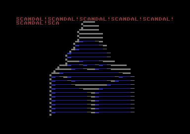

# tinyceptor

My Commodore 64 entry to Zoo 2026 two block compo where it placed 6th. Compiled program is 508 bytes long.

Tools used:  
Vasm: http://sun.hasenbraten.de/vasm/  
Retrodebugger: https://github.com/slajerek/RetroDebugger  
VSCodium: https://github.com/VSCodium/vscodium  
Denise: https://github.com/piciji/denise  
Vice: https://vice-emu.sourceforge.io/  